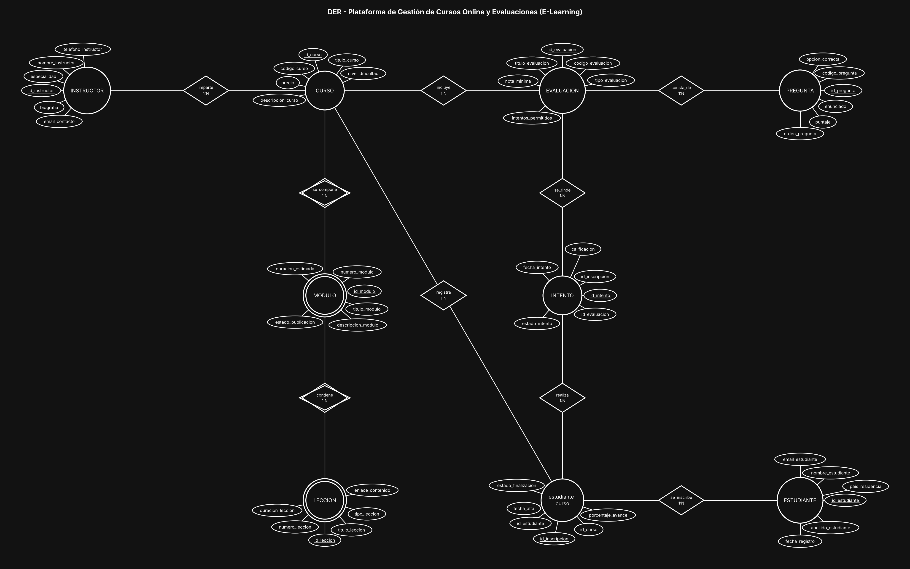

# BaseDeDatos-U1-Ej09-PlataformaELearning

Base de Datos - Unidad 1 - Ejercicio 9

## Consigna

Modelar una plataforma de cursos online (MOOC): instructores que dictan cursos, cursos compuestos por módulos y lecciones, inscripción de estudiantes con seguimiento de avance, y evaluaciones con preguntas de opción múltiple e intentos de resolución.

## Lógica

**Jerarquía CURSO → MODULO → LECCION como composición con entidades débiles.** El módulo no existe fuera de su curso y la lección no existe fuera de su módulo: son composición, no asociación. Por eso van con círculo doble y rombo doble (relación identificatoria). Cada una lleva su PK `id_modulo` / `id_leccion`, y la identidad lógica es `id_curso` + `numero_modulo` para el módulo y `id_modulo` + `numero_leccion` para la lección (UNIQUE compuesto). Esto además resuelve el orden secuencial que pide el enunciado: el número forma parte de la identidad, no es un campo suelto.

**Unicidad vs reutilización de contenidos (punto 4).** El enunciado dice que el curso está compuesto por módulos, o sea contenido exclusivo de ese curso: un módulo pertenece a uno y solo un curso, y una lección a un solo módulo. Por eso son 1:N con entidad débil y no N:M. Si el negocio quisiera reutilizar la misma lección en varios cursos (por ejemplo un módulo introductorio común), habría que convertir LECCION en entidad fuerte con PK propia y crear una intermedia `curso-leccion`, perdiendo la dependencia de existencia. Se modeló la versión del enunciado y se deja señalada la alternativa.

**INSTRUCTOR 1:N CURSO.** El enunciado dice que un instructor puede crear e impartir varios cursos, pero no que un curso tenga varios instructores, así que no hace falta una N:M. Si más adelante se quisieran cursos co-dictados, se agrega una intermedia `instructor-curso` con el rol de cada uno.

**Estudiante ↔ Curso: N:M con `estudiante-curso`.** `fecha_alta`, `porcentaje_avance` y `estado_finalizacion` son atributos de la inscripción, no del estudiante ni del curso: el mismo alumno avanza distinto en cada curso. Además, como el enunciado habla de inscribirse "a lo largo del tiempo", la fecha permite distinguir cursadas repetidas.

**EVALUACION colgada del CURSO y PREGUNTA colgada de la EVALUACION (1:N).** La evaluación pertenece al curso y las preguntas a su evaluación. Se dejó PREGUNTA como entidad fuerte con código propio (no débil) para permitir un banco de preguntas reutilizable a futuro sin rehacer la estructura, que es el caso de uso típico de un MOOC con cuestionarios generados al azar.

**INTENTO como resolución del N:M entre la inscripción y la evaluación.** El intento no se cuelga del estudiante sino de `estudiante-curso`: así cada intento queda atado a la cursada concreta en la que se rindió, y si el alumno vuelve a inscribirse al mismo curso el año siguiente sus intentos no se mezclan. Guarda `fecha_intento`, `calificacion` y `estado_intento`. Al ser una entidad y no un atributo, soporta varios intentos por evaluación, que es justamente lo que pide el enunciado (y lo que limita `intentos_permitidos` en EVALUACION).

**Convención de claves.** Toda entidad lleva como PK un identificador propio `id_<entidad>` (subrayado en el diagrama) y al menos 5 atributos además del id; el código o documento de negocio (`dni`, `codigo_*`, `legajo`, etc.) queda como atributo común con restricción UNIQUE. Las entidades intermedias de las relaciones N:M llevan los tres ids: el propio y las dos FK de las entidades que unen (UNIQUE compuesto sobre ambas FK).

## Resultado

